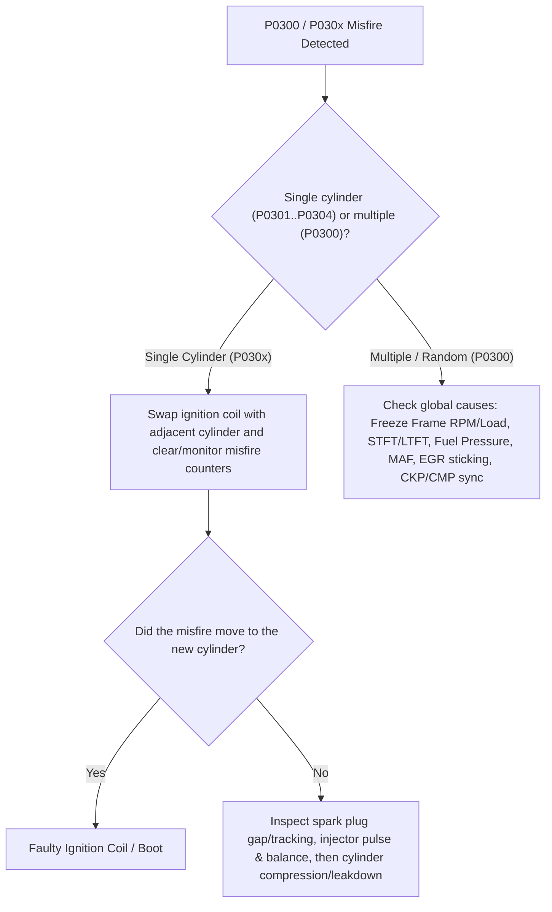

# DTC Diagnostics Guide (OBD-II, UDS ISO 14229 & SAE J1939)

This guide explains how Diagnostic Trouble Codes (DTCs) are structured, encoded on the CAN bus, cross-referenced between passenger/light-commercial vehicles (**OBD-II / UDS**) and heavy-duty commercial fleets (**SAE J1939**), and diagnosed systematically in **TorqueBus Studio** without replacing parts blindly.

> **Golden Rule of Diagnostics:** First understand the code structure, then inspect Freeze Frame and Live Data under the operating condition where the fault occurred, and only touch physical components after verifying wiring, power/grounds, and actuator response.

---

## 1. DTC Structure (`L D D D D`) and 24-Bit UDS Encoding

A Diagnostic Trouble Code (defined by **SAE J2012** and **ISO 15031-6**, and carried over **ISO 14229-1 UDS** service `0x19`) uses a five-character alphanumeric code (`L D D D D`) packed into three bytes on the wire:

```
Byte 0 (High Byte)         Byte 1 (Middle Byte)       Byte 2 (Failure Type Byte)
+---------+---------+      +---------+---------+      +-------------------+
| Bits 7-6| Bits 5-4|      | Bits 3-0| Bits 7-0|      |     Bits 7-0      |
| Family  |  Scope  |      |Subsyst. |  Fault  |      | ISO 15031-6 / UDS |
| P/C/B/U | 0/1/2/3 |      | 2nd Dig |  Index  |      | Failure Subtype   |
+---------+---------+      +---------+---------+      +-------------------+
```

### Family Letter (`L`)
| Letter | Bits `7..6` | Vehicle Area | Typical Modules |
| :--- | :---: | :--- | :--- |
| **`P`** | `00` | **Powertrain** | Engine (ECM/PCM), Transmission (TCM), Hybrid/EV Driveline |
| **`C`** | `01` | **Chassis** | ABS, ESP/ESC, Electronic Power Steering (EPS), Active Suspension |
| **`B`** | `10` | **Body** | Airbags/SRS, Body Control Module (BCM), HVAC, Immobilizer, Doors |
| **`U`** | `11` | **Network** | CAN / LIN / FlexRay bus communication, Gateway, Lost node messages |

### First Digit — Scope (`0 / 1 / 2 / 3`)
* **`0` (Generic — SAE / ISO Standard):** Universal across all manufacturers (`P0xxx`, `C0xxx`, `B0xxx`, `U0xxx`). Provides a common diagnostic baseline.
* **`1`, `2`, `3` (Manufacturer-Specific / OEM):** Defined by the vehicle manufacturer (`P1xxx`, `B1xxx`, etc.), though `P2xxx`, `P34xx`, `U2xxx`, and `U3xxx` also include ISO/SAE-controlled blocks. Always consult OEM service documentation when diagnosing manufacturer-specific codes.

### Second Digit — Subsystem (`0..9`, `A..F`)
For **Powertrain (`P`)** codes, the second digit pinpoints the subsystem:

| 2nd Digit | Powertrain Subsystem | Representative Example | Quick Meaning |
| :---: | :--- | :--- | :--- |
| **`0`** | Fuel & Air Metering and Auxiliary Emission Controls | `P0011`, `P0087` | Camshaft timing over-advanced / Fuel rail pressure too low |
| **`1`** | Fuel and Air Metering | `P0171`, `P0101`, `P0128` | System too lean (Bank 1) / MAF range / Coolant thermostat |
| **`2`** | Fuel and Air Metering (Injector Circuit & Boost) | `P0200`, `P0299` | Injector circuit / Turbocharger underboost |
| **`3`** | Ignition System or Misfire | `P0300`, `P0301`, `P0335` | Random/multiple misfire / Cylinder 1 misfire / CKP sensor |
| **`4`** | Auxiliary Emission Controls | `P0420`, `P0401`, `P0442` | Catalyst efficiency low / EGR flow insufficient / EVAP leak |
| **`5`** | Vehicle Speed, Idle Control & Auxiliary Inputs | `P0500`, `P0562`, `P0563` | Vehicle speed sensor / System voltage low or high |
| **`6`** | Computer & Auxiliary Output Circuits | `P0606` | ECM/PCM processor fault |
| **`7`–`9`, `A`–`F`** | Transmission, Driveline & Hybrid Propulsion | `P0700`, `P0730`, `P0A80` | Transmission control system / Incorrect gear ratio / Hybrid pack |

---

## 2. OBD-II / UDS vs. SAE J1939 (`SPN` / `FMI`)

Light-duty passenger vehicles and vans use **OBD-II / UDS** (`P/B/C/U` codes), whereas heavy-duty trucks, buses, agricultural, and construction equipment use **SAE J1939** (`DM1` active faults and `DM2` previously active faults).

| Feature | OBD-II / UDS (ISO 14229) | SAE J1939 (J1939-73) |
| :--- | :--- | :--- |
| **Target Vehicles** | Passenger cars, light commercial vans | Heavy-duty trucks, buses, off-highway machinery |
| **Identifier Format** | 5-character `L D D D D` (`P0171`, `U0100`) | **SPN** (19-bit Suspect Parameter Number) + **FMI** (5-bit Failure Mode Identifier) |
| **Transport Service** | UDS Service `0x19` (`ReadDTCInformation`) / `0x14` (`ClearDiagnosticInformation`) | PGN `65226` (`DM1` Active) / PGN `65227` (`DM2` Previously Active) / PGN `65228` (`DM3` Clear) |
| **Status Tracking** | 8-bit ISO 14229 Status Availability Mask (`active`, `pending`, `confirmed`, `MIL`) | 4 two-bit lamp states (`MIL`, `Red Stop`, `Amber Warning`, `Protect`) + 7-bit Occurrence Count (`OC`) |

### Mental Bridge: Common `P-Code` ↔ `SPN / FMI` Equivalents

While there is no strict 1:1 mathematical formula between every OBD-II code and J1939 code, both report the same physical subsystem and failure mode:

| OBD-II / UDS Code | Subsystem / Description | SAE J1939 Equivalent (`SPN` / `FMI`) |
| :--- | :--- | :--- |
| **`P0101`** | Mass Air Flow (MAF) Sensor Range/Performance | `SPN 132 / FMI 2` (Engine Intake Air Mass Flow Rate — erratic/incorrect) |
| **`P0113`** | Intake Air Temperature (IAT) Sensor High | `SPN 105 / FMI 3` (Intake Manifold 1 Temperature — voltage above normal) |
| **`P0118`** | Engine Coolant Temperature (ECT) Sensor High | `SPN 110 / FMI 3` (Engine Coolant Temperature — voltage above normal) |
| **`P0128`** | Coolant Thermostat Below Regulating Temperature | `SPN 110 / FMI 18` (Engine Coolant Temperature — below normal range, moderately severe) |
| **`P0171`** | System Too Lean (Bank 1) | `SPN 4237 / FMI 0` (Short/Long Term Fuel Trim — above normal range) |
| **`P0299`** | Turbocharger / Supercharger Underboost | `SPN 102 / FMI 18` (Engine Intake Manifold #1 Pressure — below normal range) |
| **`P0300`** | Random / Multiple Cylinder Misfire Detected | `SPN 1322 / FMI 11, 14` (Engine Misfire for Multiple Cylinders) |
| **`P0301`** | Cylinder 1 Misfire Detected | `SPN 1323 / FMI 11` (Engine Cylinder 1 Misfire Rate) |
| **`P0420`** | Catalyst System Efficiency Below Threshold | `SPN 3050 / FMI 18` (Catalyst 1 System Monitor — below normal range) |
| **`P0562`** | System Voltage Low | `SPN 168 / FMI 4, 18` (Battery Potential / Power Input 1 — below normal) |
| **`P0563`** | System Voltage High | `SPN 168 / FMI 3, 16` (Battery Potential / Power Input 1 — above normal) |
| **`C0035`** | Left Front Wheel Speed Sensor Supply/Circuit | `SPN 789 / FMI 2, 4, 5` (Wheel Sensor ABS Axle 1 Left — erratic/open) |
| **`U0035`** | Vehicle Communication Bus A Performance | `SPN 639 / FMI 2, 19` (J1939 Network #1 — erratic or error) |
| **`U0100`** | Lost Communication with ECM/PCM "A" | `SPN 639 / FMI 9, 19` (Abnormal update rate / network data error from SA `0x00`) |

---

## 3. Step-by-Step Diagnostic Workflow

### Step 1: Global Scan & Network Priority (`U-Codes` First)
Always inspect network and voltage codes before chasing sensor faults:
* If **`U0100`** (Lost Communication with ECM) or **`U0035`** appears alongside sensor codes, **do not condemn the ECU**. Check fuse/relay power feeds, chassis grounds, and CAN bus termination resistance (`60 Ω` between `CAN_H` and `CAN_L` with the battery disconnected; `~120 Ω` per end resistor).
* If **`P0562`** (System Voltage Low) is present, resolve battery/alternator/ground voltage drops first—low voltage triggers false sensor and ABS/EPS faults across multiple modules.

### Step 2: Freeze Frame & Live Data Correlation
A **Freeze Frame** is the snapshot captured at the exact moment the fault was stored (RPM, engine load, coolant temperature, vehicle speed, battery voltage, fuel trims).
* **Fuel Trims (`STFT` + `LTFT`) for `P0171` / `P0172`:**
  * Normal combined fuel trim is typically within `±10%`.
  * **High positive trim (`> +15%` to `+25%`) at idle (`~750 RPM`) that improves at `2,500 RPM`:** Classic intake vacuum leak downstream of the MAF sensor.
  * **High positive trim that worsens under load/high RPM:** Fuel delivery restriction (weak fuel pump, clogged filter, low rail pressure) or under-reporting MAF sensor.

### Step 3: `P0300` Misfire Decision Tree
When diagnosing **`P0300`** (Random/Multiple Cylinder Misfire) or **`P030x`** (Single Cylinder Misfire):



### Step 4: Status Bits, Clearing & Drive Cycle Verification
In UDS `0x19 0x02` (`ReadDTCInformation`), each 3-byte DTC is followed by an **ISO 14229-1 status byte**:
* `Bit 0 (0x01)` — **TestFailed (`active`)**: Fault is currently present on the most recent test sample.
* `Bit 2 (0x04)` — **PendingDTC (`pending`)**: Detected on the current or last drive cycle; awaiting confirmation.
* `Bit 3 (0x08)` — **ConfirmedDTC (`confirmed`)**: Matured fault stored in non-volatile memory.
* `Bit 7 (0x80)` — **WarningIndicatorRequested (`MIL on`)**: Check Engine Light requested.

**Never clear codes (`0x14 FF FF FF`) before recording the Freeze Frame.** After repairing the root cause and clearing DTCs, run a verification drive cycle and confirm that `pending` and `active` bits remain `0` and readiness monitors complete.

---

## 4. Using DTC Diagnostics in TorqueBus Studio

1. **Automatic UDS `0x59 0x02` Decoding in the Diagnostics Panel:**
   * When an ECU responds to UDS service `0x19 0x02` (`ReadDTCInformation`), TorqueBus Studio automatically parses every 4-byte record, formats the `P/C/B/U` code, decodes the ISO 14229 status bits (`active`, `pending`, `confirmed`, `MIL on`), and displays the code summary alongside its **SAE J1939 `SPN/FMI` cross-reference**.
2. **Interactive DTC Lookup & Diagnostic Guide:**
   * At the bottom of the **Diagnostics** panel, use the **DTC Lookup** input box or the **Common DTCs** dropdown at any time (even offline without an active measurement).
   * Type any 5-character code (`P0300`, `P0171`, `U0100`, `C0035`, `B1000`) or 3-byte UDS hex (`01 28 00`) to see its full `L D D D D` breakdown, 24-bit UDS hex representation, J1939 equivalent, Freeze Frame / Live Data first checks, and step-by-step troubleshooting guide.
   * Clicking any decoded `DTC` row in the Diagnostic Console log automatically loads that code into the Diagnostic Guide.
3. **SAE J1939-73 FMI Descriptions in the J1939 Network Panel:**
   * Active (`DM1`) and previously active (`DM2`) faults in the **J1939 Network** panel include the full **SAE J1939-73 Table 2** Failure Mode Identifier description (e.g., `FMI 4 (Voltage below normal, or shorted to low source)`).
